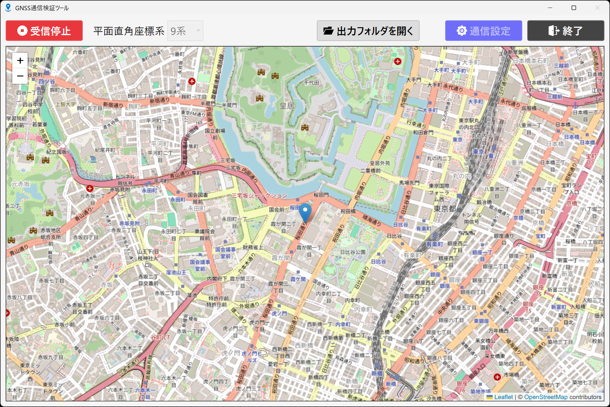
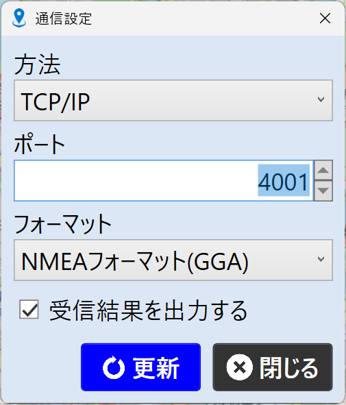

# GnssTester

GNSS/GPS対応アプリの検証ツール、GnssSimulator用の受信確認ツールです。

TCP/UDPで送られてくる位置情報（緯度経度・平面直角座標・NMEA）を受信し、地図上にその位置をプロットします。「送信側のアプリが、本当に想定通りの正しい位置情報を送れているか」を、目で見て確認するためのツールです。

https://github.com/ShunGikuSC57/GnssTester

---

## GnssSimulatorとの関係

[GnssSimulator](https://github.com/ShunGikuSC57/GnssSimulator)が「位置情報を送信する側」の検証ツールなのに対し、GnssTesterは「位置情報を受信する側」の検証ツールです。

## できること・できないこと

- 受信したメッセージが位置情報としてパースできた場合のみ、地図上にピンを打ちます。
- 受信結果はCSV出力（任意）できますが、これも位置情報としてパースできたデータのみが対象です。受信した生メッセージやバイト列そのものをログとして残す機能はないため、TCP/UDPの疎通確認や通信内容そのものの調査には使えません。あくまで「位置として正しく解釈できるか」の確認に特化しています。
- NMEAはGGA/RMCから緯度経度を取り出すことだけを目的にしており、衛星捕捉数やDOP値、Fix品質、チェックサムの検証といった位置情報以外の項目は扱っていません。
- 平面直角座標系番号の指定が必要なのは、受信フォーマットとして平面直角座標系を選んだ場合のみです。緯度経度やNMEAを受信する場合は設定不要です。

---
## 対応フォーマット

| フォーマット | 例 |
| --- | --- |
| 緯度経度 | `35.681236,139.767125` |
| 緯度経度（JSON） | `{"Latitude":35.681236,"Longitude":139.767125}` |
| 平面直角座標系 | `12345.678,-6789.012` |
| 平面直角座標系（JSON） | `{"X":12345.678,"Y":-6789.012}` |
| NMEA（GGA） | `$GPGGA,123519,4807.038,N,01131.000,E,1,08,0.9,545.4,M,46.9,M,,*47` |
| NMEA（RMC） | `$GPRMC,123519,A,4807.038,N,01131.000,E,022.4,084.4,230394,003.1,W*6A` |

---
## 使い方

1. 通信設定画面で、方法（TCP/UDP）・ポート番号・受信フォーマット・CSV出力有無を設定します。
2. 受信フォーマットに平面直角座標系を選んだ場合のみ、系番号（1〜19系）をメイン画面で指定します。
3. 受信開始ボタンを押すと待ち受けを開始します。対象アプリからデータを送信すると、地図上に位置が表示されます。
4. 別PCから受信する場合、環境によってはファイアウォールで受信がブロックされることがあります。その場合は使用しているポート番号の受信を明示的に許可してください。

---
## 技術構成

- **.NET 10 / WPF**：あえてMVVMを使わず、コードビハインドで実装しています。デバッグ用のツールなので凝った作りにする必要はなく、それよりも画面の要素とロジックが直接結びついている方が、コードを読んだときにどのボタンが何をしているか追いやすく、ちょっと直したい人にとって手を入れやすいだろうという判断です。

---
## 動作環境
- Windows 10 以降（自己完結型で配布しているので、.NET Desktop Runtimeのインストールなしで動作します）
- インターネット接続（地図表示にLeaflet/OpenStreetMapを外部から読み込むため。オフライン環境では地図が表示されません）

---
## 使用ライブラリ
- [Microsoft.Web.WebView2](https://learn.microsoft.com/microsoft-edge/webview2/) - 地図表示
- [Leaflet](https://leafletjs.com/) - 地図描画（WebView2内で使用）
- 地図タイル: [OpenStreetMap](https://www.openstreetmap.org/copyright) contributors

---
## ライセンス
MIT License